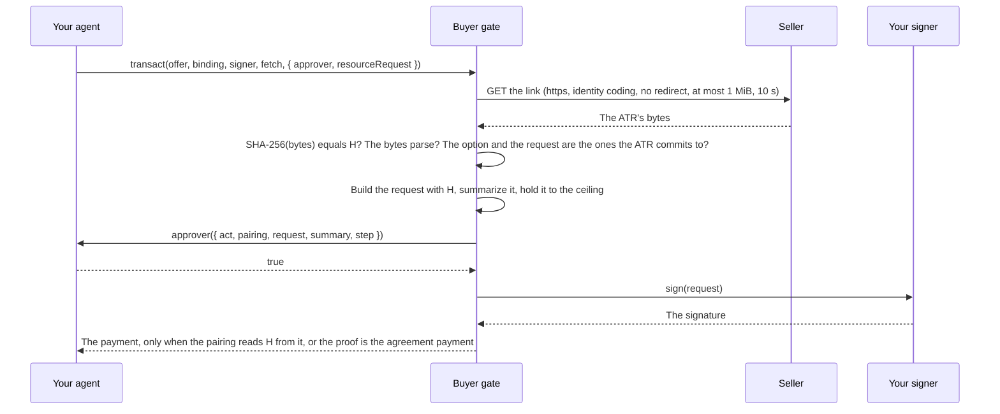

# @integraledger/terms

The buyer gate for agents that pay: before your wallet signs anything, it confirms that the record a seller serves
hashes to the value the payment will carry, and builds the payment with that hash.

```sh
npm install @integraledger/terms@0.5.0 @integraledger/lcp@0.6.0
```

## What it is

A seller that follows the Legal Context Protocol publishes the agreement's record, an **Agentic Transaction Record
(ATR)**, at an `https` link, and advertises its hash beside the payment request. Where the payment your agent approves
carries that hash, that approval is the buyer's acceptance of that exact record; where it does not, the pairing's
`proves` says so.

That only holds if the hash in the payment is the hash of the record you can read. This package is the check that makes
sure it is. It fetches the record, computes its SHA-256, compares it with what the seller advertised, parses the bytes,
holds the option you pay (and on x402 the request you make) to what the record's binding slot commits to, and only then
builds a request with that hash. Before your signer is called, `transact` shows your approver what the
signature grants (the amount, the payees, the asset, the network and how long the payment stays payable) and declines a
payment that would stay payable past its ceiling. After your signer answers, the pairing reads the hash back from the completed payment, and the payment
is returned only if it is the hash of the bytes you received, or, where the proof is the agreement payment, without
that reading.

It runs in your process, with your HTTP client, your signer and your approver. It holds no keys and judges none of the
record's terms: what the record says is for you and your principal to judge. The one payment it sends is the agreement
payment your approver approved, to the agreement URL.

The checks, their order, the decline each answers and the names of their arguments are fixed, for this package and the
Python gate alike, by the profile [`profiles/buyer-gate.md`](./profiles/buyer-gate.md), which ships in this package.

## Key concepts

- **Agentic Transaction Record (ATR):** the agreement's record: the exact bytes the seller serves; `assemble` in
  `@integraledger/lcp` writes them as one JSON object.
- **ATR hash (H):** SHA-256 over the ATR's exact bytes, `0x` and 64 hex digits. It is computed over the bytes as
  received, never over a parsed and re-serialised copy.
- **Legal Context Protocol (LCP):** the pattern this package implements: where the payment the buyer approves carries
  H, that approval is the buyer's acceptance of that exact record; where it does not, the pairing's `proves` says so.
- **Pairing:** a payment protocol, scheme and rail combination, such as `x402/exact/eip155/eip3009`.
- **Binding:** how H rides in a pairing's payment: the field of that payment, as the protocol's own specification
  defines the payment, that carries H. For `x402/exact/eip155/eip3009` it is the EIP-3009 `nonce`. Bindings are exported
  by [`@integraledger/lcp`](https://github.com/IntegraLedger/integra-protocol), one per pairing.
- **Coverage:** whether a pairing's payment is itself a public proof of H, as the protocol package's registry states it
  for each pairing (`data.coverage`): `full` where the payer's own signed act on a public ledger binds all of H, and
  `none` otherwise. A pairing at `none` is paid only after an **agreement payment**, a payment at `full` carrying H, to
  the seller's agreement URL.
- **Buyer gate:** this package: the buyer-side check that compares the served bytes with H, and holds what is about to
  be signed to the ATR, before anything is signed.
- **Approver:** your callback, which `transact` asks about each signing, with its **summary**: every authority the
  signature grants, read from the request the signer is handed.
- **Ceiling:** the longest a signed payment may stay payable, 600 seconds unless you raise it for a pairing.
- **Seller:** the party serving the resource.
- **Facilitator:** the x402 role that verifies and settles. The gate never talks to one. It returns the payment to you,
  except the approved agreement payment, which it sends to the agreement URL.
- **Vectors:** the shared test cases that fix the rules byte for byte across languages. This package and the Python
  gate, [`integraledger-terms`](https://pypi.org/project/integraledger-terms/), run the same `buyer` rows and pairing
  vectors.

## Install

```sh
npm install @integraledger/terms@0.5.0 @integraledger/lcp@0.6.0
```

- Node.js `>=24.22.1`. ESM only.
- `@integraledger/lcp` is a peer dependency of this package (`~0.6.0`, any 0.6.x release): install it beside it, so
  your application and the gate share one copy, and import from it the bindings you pass in.
- Chain libraries are optional peers of `@integraledger/lcp`: `@mysten/sui`, `@solana/kit`, `@stellar/stellar-sdk`,
  `@ton/core`, `algosdk`, `borsh` and `ripple-binary-codec`, at the versions `@integraledger/lcp` names. Install the
  ones the pairings you pay use.

## Quickstart

The seller answered with an x402 `402 Payment Required` whose `PAYMENT-REQUIRED` document advertises H and the link.
This example pays it with [viem](https://viem.sh) as the wallet (`npm install viem`). It uses the ATR, the document and the payer key of
the shared vectors, and a local stand-in for the network, so it runs offline and prints the same values every time.

```ts
import { transact, type Fetch, type Signer } from "@integraledger/terms";
import { exactEip3009, type Eip3009Payment } from "@integraledger/lcp/x402";
import { privateKeyToAccount } from "viem/accounts";

// The ATR, exactly as the seller's link serves it. The gate hashes and parses these bytes, never a copy.
const atr = new TextEncoder().encode(
  '{"atrVersion":"1","id":"0f8fad5b-d9cb-469f-a165-70867728950e","x402":{"z":1.0,"a":"caf\\u00e9"},"seller":{"note":"Café — 30 días ✓"}}',
);
const H = "0x8b1e122580ae3f6a8c3d36a24294e1260a87bde70f597279b973e39310072938";
const link = `https://atr.seller.example/${crypto.randomUUID()}`;

// The seller's x402 payment request, advertising H and the link.
const offer = {
  x402Version: 2,
  resource: { url: "https://api.seller.example/v1/quote" },
  accepts: [
    {
      scheme: "exact",
      network: "eip155:84532",
      amount: "10000",
      asset: "0x036CbD53842c5426634e7929541eC2318f3dCF7e",
      payTo: "0x209693Bc6afc0C5328bA36FaF03C514EF312287C",
      maxTimeoutSeconds: 60,
      extra: { name: "USDC", version: "2" },
    },
  ],
  extensions: {
    legalContext: { info: { type: "sha256", value: H, legalContextUrl: link }, schema: {} },
  },
};

// A stand-in for the network: the link serves the ATR. In production, pass globalThis.fetch.
const fetch: Fetch = async (url) => (url === link ? new Response(atr) : new Response(null, { status: 404 }));

// The published Anvil development key. Never use it for real funds.
const wallet = privateKeyToAccount("0xac0974bec39a17e36ba4a6b4d238ff944bacb478cbed5efcae784d7bf4f2ff80");
const signer: Signer = {
  account: `eip155:84532:${wallet.address}`,
  async sign(request) {
    if (request.kind !== "eip712") throw new Error(`this wallet signs EIP-712 only, not ${request.kind}`);
    return wallet.signTypedData(request.typedData as Parameters<typeof wallet.signTypedData>[0]);
  },
};

const result = await transact(offer, exactEip3009, signer, fetch, {
  // The request the seller's 402 answered, as your agent made it.
  resourceRequest: { method: "GET", target: "/v1/quote", body: new Uint8Array() },
  // Asked once for each signing, before the signer is called, with what the signature grants.
  approver: (toSign) => {
    const { amount, payees, network } = toSign.summary;
    console.log("approve     ", toSign.act, amount, "to", payees[0]?.account, "on", network);
    return true;
  },
});
if ("decline" in result) throw new Error(`${result.decline.code}: ${result.decline.detail}`);
if ("approve" in result || "charge" in result || "agreementChallenges" in result) {
  throw new Error("this pairing pays no agreement first");
}

const payment = result.signed as Eip3009Payment;
console.log("H           ", result.h);
console.log("signed nonce", payment.payload.authorization.nonce);
console.log("kept bytes  ", result.bytes.length);

// x402 over HTTP sends the payment as base64 of the UTF-8 bytes of its JSON, in the PAYMENT-SIGNATURE header.
const header = Buffer.from(JSON.stringify(result.signed), "utf8").toString("base64");
console.log("header      ", header.length > 0 ? "ready" : "empty");
```

```text output
approve      payment 10000 to 0x209693Bc6afc0C5328bA36FaF03C514EF312287C on eip155:84532
H            0x8b1e122580ae3f6a8c3d36a24294e1260a87bde70f597279b973e39310072938
signed nonce 0x8b1e122580ae3f6a8c3d36a24294e1260a87bde70f597279b973e39310072938
kept bytes   138
header       ready
```

Your approver was shown what the signature grants, read from the request the wallet signed, and the nonce your wallet
signed is the hash of the 138 bytes the link served. Keep `result.bytes` with the payment: they are your copy of the
record.

If the link had served one byte more, less or different, `transact` would have returned
`{ decline: { code: "hash-mismatch", … } }` and never called the approver or the signer. Had the approver answered
anything but `true`, it would have returned `{ decline: { code: "not-approved", … } }` and never called the signer.

Against a live seller you decode its `402` yourself, pick the binding of the option you pay, and send what `transact`
returns: [Against a live seller](https://github.com/IntegraLedger/integra-agentic-terms/blob/main/docs/getting-started.md#against-a-live-seller)
walks through it.

## How it works



1. **Read.** The pairing's binding reads the seller's document: H, the link, and the payment options.
2. **Compare.** The gate fetches the link once and hashes the bytes it received. No match: a decline, and no signer
   call.
3. **Parse and hold.** The gate parses the bytes it hashed, by one grammar both languages read alike. Where the ATR's
   `x402` slot lists `accepts`, or its `mpp` slot `challenges`, the option chosen must be one of them; where the `x402`
   slot holds a commitment to the buyer's request, `resourceRequest` must be that request. Other slots are not
   compared.
4. **Build.** The gate builds the payment with the hash it computed, not the string the seller advertised.
5. **Show.** The gate computes the summary of the request your signer would be handed, declines a payment that would
   stay payable past its ceiling, and asks your approver.
6. **Sign and finish.** Only on `true` does it call your signer. It joins the answer and returns the payment only when
   the pairing reads H back from the completed payment as the hash of the compared bytes, or, where the proof is the
   agreement payment, without that reading.

`confirm` and `finish` split this order at the signer: `confirm` makes steps 1 to 5 but the approver, and returns the
request and its summary. Every function returns a value, never throws for a protocol outcome: either its result, or
`{ decline: { code, detail } }`; nothing the seller serves and nothing your approver answers makes it throw.

## Guides

### Pay with `transact`

`transact(doc, binding, signer, fetch, options)` runs the whole order: compare, check, pay the agreement where the
pairing needs one, ask your approver, sign, finish. For most pairings that is one call. For a pairing that needs an
agreement payment, the first call returns that payment for your agent's approval, and a second call, with `approved`,
pays it and then the resource. Every signing, the agreement payment's among them, is asked of your `approver` before the
signer is called for it; the gate judges no term and applies no spending limit, so what to approve is your approver's
decision. Its result is:

| Member | What it is |
| --- | --- |
| `signed` | The payment to send, in the protocol's own form. `null` when the pairing gives the buyer nothing to sign. |
| `bytes` | The ATR's exact bytes: your copy of the record. |
| `h` | Their SHA-256. |
| `agreement` | The agreement's receipt, where the pairing needs an agreement payment. |
| `landed` | A landed receipt to keep beside the payment, for the few pairings that return one. |

Where the pairing needs an agreement payment that is not yet recorded, the result is instead
`{ approve, bytes, h }`, and nothing has been signed: see [Pay the agreement first](#pay-the-agreement-first). Where the
pairing is paid after its agreement and the first response offers the agreement alone, the result is `ToReturn`: see
[Paid after its agreement](#paid-after-its-agreement). Where the agreement URL offers only MPP agreement challenges, the
result is `AgreementChallenges`, `{ agreementChallenges, bytes, h }`, and nothing has been signed: see
[Pay the agreement first](#pay-the-agreement-first).

`options` takes:

| Member | What it is |
| --- | --- |
| `approver` | Required. Your approval callback: `(toSign: ToSign) => boolean \| Promise<boolean>`. It is called once for each signing, after every check and before the signer, and approves only by answering `true`. Anything else, a throw or a rejection declines `not-approved`. |
| `resourceRequest` | Required. The request the seller's offer answered, exactly as your agent sent it. Over HTTP `{ method, target, body, headers? }`: the method token; the origin-form request-target, the path and query starting with `/` (such as `/v1/quote?city=Paris`), never the full URL; the body's bytes (a `Uint8Array`, empty for none); and `headers`, each field's name with its value or its lines in the order sent. Over MCP the tool call `{ name, arguments? }`. Where the ATR's `x402` slot holds a request commitment, the gate holds this request to it, and a target that is not origin-form is declined `request-mismatch` with `x402/request-target-invalid`. |
| `inputs` | The buyer's own values a build needs, such as a recent blockhash, and the floor a rail's payment service serves. |
| `ceilings` | The raised ceilings: a pairing id mapped to seconds, or to `"no-end"`. See [Ceilings and floors](#ceilings-and-floors). |
| `legalContext` | The first response's `Legal-Context` value, as received, where it carried one. |
| `agreementSigner` | The wallet that pays the agreement, where it is not `signer`. |
| `approved` | The agreement payment your agent approved, exactly as a previous call returned it in `approve`. |
| `signal` | An `AbortSignal` that ends the agreement exchange. |
| `chosen` | The payment `confirm` chose, unchanged: `transact` then builds that exact request rather than choosing anew. |

Any other member, or a member of the wrong kind, is declined `no-payable-option` with `<namespace>/input-malformed`
before any fetch.

### What the approver is shown

`toSign` holds the act, the pairing, the request the signer will be handed, its `summary` and the `step` (`index` from
0, of `count` signings, the number the pairing's payment takes, at most two). The act is `"payment"`, the payment for
the resource, or `"agreement"`: the agreement payment, and every payment through a pairing whose agreement is never a
charge (its data in the protocol package's registry holds `agreement.only`, as `spend-permissions/eip155`'s and
`x402/exact/stellar/precondition`'s do). The `summary` is computed from the request handed to the signer, never from the
seller's option, so a request that grants more than the offer is shown granting it:

| Member | What it holds |
| --- | --- |
| `amount` or `maximum` | What the payee is paid, or the most the payee may charge (`upto`), in the asset's base units. |
| `payees` | Every payee, `{ account, amount }`. On an authorization and capture, the fee's payee too, with the most it may take of the maximum. |
| `asset` | The asset, as the form names it. |
| `network` | The CAIP-2 network, or `null` where the payment moves on no ledger (a card network, a fiat checkout). |
| `validity` | `{ notBefore, notAfter, unit }`: from and until when the signed payment is payable, in Unix seconds or the chain's unit. |
| `period`, `limitPerPeriod`, `end` | A recurring grant: a subscription's key authorization or a Spend Permission. |
| `operator`, `authorizationExpiry`, `refundExpiry` | An authorization and capture. |
| `deposit`, `closableBy` | A session's or a channel's deposit, and who may close it. |
| `grant` | What a delegation, a checkout, a session's opening (its escrow and the key that signs its vouchers) or a Circle Gateway burn intent (the network the payee is paid on, and the most Gateway may take as its fee) grants, as JSON. |
| `atr` | The ATR's bytes the gate hashed, parsed and compared. |

A request of a kind the gate has no summary for is declined `summary-missing`: nothing is signed unshown. The profile's
rule 13 has the table of which signed field fills each member, for every request kind. A pairing whose build hands the
signer no request, one with nothing for the buyer to sign or whose build is itself the payment, has no summary: nothing
is signed, and its agreement payment is shown by its own pairing's row. A later step that names only its channel, such
as a session's voucher, is shown with the payees, asset, network and validity of the opening, once the gate has
recomputed the channel the opening opens for your account; a voucher of another channel has no summary.

### Ceilings and floors

The gate declines a payment that would stay payable longer than its pairing's ceiling, `past-ceiling`, and one that
signs no end, such as a delegation or a card checkout, `no-end`. A pairing's ceiling is 600 seconds unless `ceilings`
raises it: `{ "x402/exact/sui": 86400 }` raises one pairing's ceiling to a day, and `{ "card/visa-tap": "no-end" }`
admits a form that signs no end. An id the call does not pay is not read. A deadline signed as a height, a slot, a
round, a ledger or an epoch is counted at the chain's pace, which the profile states with its source; on the XRP Ledger
the caller gives `ledgerIndex` in `inputs`, the validated ledger it read, and on Cardano and Sui `currentSlot` and
`currentEpoch`, since those requests sign no start.

Where a rail's payment service refuses a shorter validity, the caller reads the floor that service serves and gives it
in `inputs`, under the name the build takes; the gate reads no service of its own, and a missing floor input is
declined `floor-missing`, its detail the input's name. `FLOOR_INPUTS` maps each such pairing to the names of its floor
inputs. That rail's ceiling is the served floor plus the service's margin:

| Pairing | Floor inputs | Ceiling |
| --- | --- | --- |
| `x402/exact/eip155/gateway-batched` | `minValiditySeconds`, the minimum Circle Gateway's `/supported` serves for the network | `minValiditySeconds` plus 100 seconds |
| `mpp/charge/usdc/gateway` | `sourceNetwork`, the CAIP-2 network the burn intent spends from; `burnIntentExpirationHeight`, the height Circle Gateway's `GET /v1/info` serves for it; `withdrawalDelay`, that network's Gateway Wallet's `withdrawalDelay()`, in blocks | the burn intent's `maxBlockHeight` at `burnIntentExpirationHeight` plus 100 seconds counted in that network's blocks |

A Gateway burn intent's deadline is a block height on the network it spends from, so the gate holds it in whole blocks:
its `maxBlockHeight` less `burnIntentExpirationHeight` is at most `withdrawalDelay` × 100 / 604,800, rounded up, the
Gateway Wallet's withdrawal delay being 7 days; a raised ceiling of R seconds admits R × `withdrawalDelay` / 604,800
blocks, rounded down, where that is more. A burn intent shown on another network than `sourceNetwork` is declined
`past-ceiling`.

### Sign elsewhere: `confirm`, then `finish`

When the key lives in a hardware wallet or a signing service, split the order. `confirm` makes every check up to the
signing (1 to 11 of the profile) and returns the request with its `summary`; it calls no approver and no signer, so
showing that summary before the request is signed is your step. `chosen` is plain JSON, so it crosses process
boundaries with the bytes. `finish` recomputes H from the bytes you hand back and rebuilds the payment from `chosen`; it
trusts both. Keep `chosen` and the bytes on your side of the boundary, or seal them, and carry `request` to the signer
over a channel you trust.

`confirm` and `finish` neither pay nor check the agreement; only `transact` and `agree` do. When `chosen.agreement` is
set, the pairing's payment is not itself a public proof of H: do not sign yet. Call
`agree(bytes, chosen.agreement, signer, fetch, { chosen })`, have your agent approve the `approve` it returns, call
`agree` again with `{ approved, chosen }`, and sign `request` only with its `receipt` in hand. Given `chosen`, `agree`
pays only an agreement option the charge's pairing admits (its `agreementOn` in the protocol package's registry: any
network, or the charge's own).

```ts
import { confirm, finish, type Fetch } from "@integraledger/terms";
import { exactEip3009, type Eip3009Payment } from "@integraledger/lcp/x402";
import { privateKeyToAccount } from "viem/accounts";

const atr = new TextEncoder().encode(
  '{"atrVersion":"1","id":"0f8fad5b-d9cb-469f-a165-70867728950e","x402":{"z":1.0,"a":"caf\\u00e9"},"seller":{"note":"Café — 30 días ✓"}}',
);
const H = "0x8b1e122580ae3f6a8c3d36a24294e1260a87bde70f597279b973e39310072938";
const link = `https://atr.seller.example/${crypto.randomUUID()}`;
const offer = {
  x402Version: 2,
  resource: { url: "https://api.seller.example/v1/quote" },
  accepts: [
    {
      scheme: "exact",
      network: "eip155:84532",
      amount: "10000",
      asset: "0x036CbD53842c5426634e7929541eC2318f3dCF7e",
      payTo: "0x209693Bc6afc0C5328bA36FaF03C514EF312287C",
      maxTimeoutSeconds: 60,
      extra: { name: "USDC", version: "2" },
    },
  ],
  extensions: { legalContext: { info: { type: "sha256", value: H, legalContextUrl: link }, schema: {} } },
};
const fetch: Fetch = async (url) => (url === link ? new Response(atr) : new Response(null, { status: 404 }));

// 1. Compare, check, and build the request with H. confirm calls no approver: show the summary yourself.
const account = "eip155:84532:0xf39Fd6e51aad88F6F4ce6aB8827279cffFb92266";
const confirmed = await confirm(offer, exactEip3009, account, fetch, {
  resourceRequest: { method: "GET", target: "/v1/quote", body: new Uint8Array() },
});
if ("decline" in confirmed) throw new Error(confirmed.decline.code);
if (confirmed.request === null || confirmed.request.kind !== "eip712") throw new Error("expected an EIP-712 request");
console.log("to approve:", confirmed.summary?.amount, confirmed.summary?.asset, confirmed.summary?.validity.unit);

// What crosses to the signing side and back: plain JSON and the bytes.
const handOff = JSON.stringify({ chosen: confirmed.chosen, atr: Buffer.from(confirmed.bytes).toString("base64") });

// 2. Sign exactly the request, elsewhere. The published Anvil development key; never use it for real funds.
const wallet = privateKeyToAccount("0xac0974bec39a17e36ba4a6b4d238ff944bacb478cbed5efcae784d7bf4f2ff80");
const signature = await wallet.signTypedData(
  confirmed.request.typedData as Parameters<typeof wallet.signTypedData>[0],
);

// 3. Finish from what came back. finish recomputes H from the bytes and rebuilds the payment from chosen.
const back = JSON.parse(handOff);
const done = await finish(new Uint8Array(Buffer.from(back.atr, "base64")), back.chosen, signature, exactEip3009);
if ("decline" in done) throw new Error(done.decline.code);
if ("next" in done) throw new Error("this pairing signs in one step");

console.log("nonce is H:", (done.signed as Eip3009Payment).payload.authorization.nonce === H);
```

```text output
to approve: 10000 0x036CbD53842c5426634e7929541eC2318f3dCF7e seconds
nonce is H: true
```

A pairing signed in two steps (a channel funding, then its first voucher) makes `finish` return `{ next, summary, h }`:
show `summary`, sign `next` and call `finish` again with every answer so far, in order, as a list. `finish` holds each
later step to its summary and its ceiling before returning it (`finish(bytes, chosen, signature, binding, { ceilings })`
takes the raised ceilings); a voucher is shown for the account `confirm` chose. `transact` does all of this for you,
asking your approver at each step.

### Pay the agreement first

Some payments are not a public proof of H: a card charge, a Stripe payment, a Lightning invoice, a checkout in which
the buyer signs nothing. For those pairings the seller's offer also names an **agreement URL**, an x402 resource for the
same H whose payment is a public proof. The agreement payment is a payment like any other, so your agent approves it
before anything is signed:

1. `transact` fetches the agreement URL's payment request and returns `{ approve, bytes, h }`, signing nothing.
   `approve.option` is the option it would pay: its `amount`, `asset`, `payTo` and `network`. `approve.url` is the
   agreement URL, and `approve.required` the payment request as served.
2. Your agent approves it as it approves any payment. To pay it, call `transact` again with the same arguments and
   `approved: approve` added to the options.
3. The second call holds that payment to its own pairing's ceiling, asks your approver about it with `act`
   `"agreement"`, signs exactly that payment, sends it, and asks about and signs the main payment only after the
   agreement URL answers with its receipt:

```json
{
  "atrHash": "0x8b1e122580ae3f6a8c3d36a24294e1260a87bde70f597279b973e39310072938",
  "agreed": true,
  "network": "eip155:84532",
  "transaction": "0xabababababababababababababababababababababababababababababababab"
}
```

- The option paid is the first, in document order, that your signer can pay with an x402 pairing whose payment can
  itself be an agreement (coverage `full` in the protocol package's registry, with an agreement form, `agreement`) and
  that the main payment's pairing admits: its `agreementOn` says whether an agreement on any network will do, or only
  one on the payment's own network.
- The agreement payment is built with the act `agreement`: on a pairing whose agreement has its own single-use value,
  the payment carries that value, computed from H, where a payment for the resource would carry H itself.
- The agreement URL's `402` must advertise the same H, or nothing is signed (`hash-mismatch`).
- Once the agreement payment is sent, the gate sends the same payment again after each `202`, `5xx` or timeout, within
  the paid option's `maxTimeoutSeconds` plus 180 seconds. Within one call it never signs a second agreement payment.
  `signal` ends the exchange sooner.
- The receipt is the agreement URL's statement: the gate checks its form and that its `atrHash` is H, and does not
  look up the transaction it names. A `200` to the first, unpaid request is the agreement URL's word alone: the gate
  made no agreement payment and read none, returns that receipt marked `unpaid: true`, and the first call goes straight
  on to the main payment.
- A pairing that needs an agreement and whose offer names none is declined with `agreement-not-offered`.
- Where the agreement URL answers with no x402 payment request and with MPP agreement challenges
  (`WWW-Authenticate: Payment`), the gate signs nothing and returns `AgreementChallenges`, `{ agreementChallenges,
  bytes, h }`, the challenges in the seller's order: terms does not send an MPP credential to the agreement URL, so
  your own MPP client pays one there, and a later call finds the agreement recorded and pays the charge.
- `agree(bytes, url, signer, fetch, { approved, inputs, ceilings, signal, chosen })` runs the exchange on its own, in
  the same two calls, for an agent that drives each step. It takes no approver: showing the agreement payment before it
  is approved is then your step. It holds the agreement payment to its summary and its own pairing's ceiling before it
  is signed, as `transact` does, `ceilings` raising it.

Once the agreement payment is sent, every decline carries it as `moved`: `agreement-pending` when it may settle yet,
and `agreement-failed` when the agreement URL answered otherwise. Either way, it has left your wallet. To collect the
receipt, call again without `approved`: the gate asks the agreement URL unpaid and goes on once it answers `200` with
the receipt, or declines `agreement-pending` again while it answers `202`, signing nothing. Never call again with
`approved` for the same agreement: every call with `approved` signs and sends a new agreement payment.

### Paid after its agreement

A seller may answer first with the agreement alone (the protocol package's profile `legal-context-return.md`): its
first response offers the agreement option and no charge, each agreement option naming, by its `serves`
(`extra.legalContextServes` on x402, the `opaque` member `legalContextServes` of an MPP agreement challenge), the
charges it is for. `transact` then chooses the charge from the options the ATR's binding slot holds, pays the agreement
option that serves it as soon as your approver approves it with `act` `"agreement"`, without returning it to your agent
first, ends at the agreement's receipt, signs no charge, and returns `ToReturn`.

Where the slot holds the charge in the form the first response would offer it, the charge is built with H and held to
its summary and its ceiling before its agreement is paid. Where the seller writes part of it only when it serves the charge, the charge
is chosen by the option's own checks, and the call that pays it makes the rest: an `x402/exact/lnbtc/payment-hash`
option, whose invoice comes later, and every MPP challenge, which the slot holds as issued.

On MPP, `transact` follows the agreement URL the agreement challenges carry and reads its one `402`: it pays an x402
agreement option there as on x402. Where that `402` offers only MPP agreement challenges, `transact` signs nothing and
`ToReturn` holds them as `agreementChallenges`, in place of `agreement`, for your own MPP client to pay at the
agreement URL:

| Member | What it is |
| --- | --- |
| `agreement` | The agreement's receipt, where `transact` paid the agreement. |
| `agreementChallenges` | The agreement resource's MPP agreement challenges, in the seller's order, where it offers no x402 agreement option. |
| `legalContext` | The `Legal-Context` value to send when you repeat your request: H's LCP string, with `rv`, the return value, where the first response carried one. |
| `charge` | The charge chosen, `<slot>/<i>`, such as `x402/0`. |
| `bytes` | The ATR's bytes the gate compared. |
| `h` | Their SHA-256. |

Pass the first response's `Legal-Context` header (over MCP, its `_meta["com.integraledger.lcp/legal-context"]`), as
received, as `legalContext`: a value the protocol package refuses is declined `offer-unreadable`, and one whose H is not
the ATR's `hash-mismatch`. Repeat your request with the returned `legalContext`, and call `transact` again with the
second response, which offers the charge: the agreement being recorded, that call pays the charge as any other.

### Channels and sessions

In an x402 batch-settlement channel or an MPP session, one ATR covers the whole channel. The gate compares it once, at
the opening; you keep a **hold** and sign every later voucher from it:

```ts
import { openChannel, recordCharge, transact, within, type Fetch, type Signature, type Signer, type SigningRequest } from "@integraledger/terms";
import { batchEvm } from "@integraledger/lcp/x402-batch-settlement";
import { privateKeyToAccount } from "viem/accounts";

const atr = new TextEncoder().encode(
  '{"atrVersion":"1","id":"0f8fad5b-d9cb-469f-a165-70867728950e","x402":{"z":1.0,"a":"caf\\u00e9"},"seller":{"note":"Café — 30 días ✓"}}',
);
const H = "0x8b1e122580ae3f6a8c3d36a24294e1260a87bde70f597279b973e39310072938";
const link = `https://atr.seller.example/${crypto.randomUUID()}`;

// The seller's batch-settlement offer: 1000 units per request, into a channel.
const offer = {
  x402Version: 2,
  resource: { url: "https://api.seller.example/v1/quote" },
  accepts: [
    {
      scheme: "batch-settlement",
      network: "eip155:84532",
      amount: "1000",
      asset: "0x036CbD53842c5426634e7929541eC2318f3dCF7e",
      payTo: "0x209693Bc6afc0C5328bA36FaF03C514EF312287C",
      maxTimeoutSeconds: 3600,
      extra: { receiverAuthorizer: "0x90F79bf6EB2c4f870365E785982E1f101E93b906", withdrawDelay: 900, name: "USDC", version: "2" },
    },
  ],
  extensions: { legalContext: { info: { type: "sha256", value: H, legalContextUrl: link }, schema: {} } },
};
const fetch: Fetch = async (url) => (url === link ? new Response(atr) : new Response(null, { status: 404 }));

// Anvil development keys: the payer funds the channel, the payer authorizer signs vouchers. Never use them for real funds.
const payer = privateKeyToAccount("0xac0974bec39a17e36ba4a6b4d238ff944bacb478cbed5efcae784d7bf4f2ff80");
const authorizer = privateKeyToAccount("0x59c6995e998f97a5a0044966f0945389dc9e86dae88c7a8412f4603b6b78690d");
type TypedData = Parameters<typeof payer.signTypedData>[0];
const signer: Signer = {
  account: `eip155:84532:${payer.address}`,
  async sign(request: SigningRequest): Promise<Signature> {
    if (request.kind !== "batch") throw new Error(`unexpected ${request.kind}`);
    const answers: Signature[] = [];
    for (const each of request.requests) {
      const typedData = (each as { typedData: TypedData }).typedData;
      const key = typedData.primaryType === "Voucher" ? authorizer : payer;
      answers.push(await key.signTypedData(typedData));
    }
    return answers;
  },
};

// Open: compare the ATR once, show the opening, sign the deposit and the first voucher.
const opened = await transact(offer, batchEvm, signer, fetch, {
  resourceRequest: { method: "GET", target: "/v1/quote", body: new Uint8Array() },
  approver: ({ summary }) => {
    console.log("opening  deposit", summary.deposit, "to", summary.payees[0]?.account);
    return true;
  },
  inputs: { payerAuthorizer: authorizer.address, deposit: "100000" },
  // The deposit's authorization stays payable for the option's 3600 seconds: raise this pairing's 600-second ceiling.
  ceilings: { "x402/batch-settlement/eip155": 3600 },
});
if ("decline" in opened) throw new Error(`${opened.decline.code}: ${opened.decline.detail}`);
if ("approve" in opened || "charge" in opened || "agreementChallenges" in opened || opened.signed === null) {
  throw new Error("the channel did not open");
}
let hold = await openChannel(opened.bytes, opened.signed, batchEvm);
if ("decline" in hold) throw new Error(hold.decline.code);
console.log("channel ", hold.channel);

// Each later request: the seller's new offer must advertise the held H.
for (const charged of ["1000", "2000"]) {
  const next = await within(offer, hold, batchEvm, signer);
  if ("decline" in next) throw new Error(next.decline.code);
  console.log("voucher up to", next.hold.signedMax);
  // The seller reports its cumulative charge; it may not exceed what was signed.
  const recorded = recordCharge(next.hold, charged);
  if ("decline" in recorded) throw new Error(recorded.decline.code);
  hold = recorded;
}
```

```text output
opening  deposit 100000 to 0x209693Bc6afc0C5328bA36FaF03C514EF312287C
channel  0x9c2d7031768ecb3fe688ae307c45f2e3a3d98b0d9ce1a6afcd27131fabb67e56
voucher up to 1000
voucher up to 2000
```

The hold is plain JSON: store it, and pass the latest one to each call. `within` takes the bytes, H and the channel from
the hold, and the amount from the new challenge. On x402's batch channels it signs only when that challenge advertises
the held H and the payment it builds names the held channel. On an MPP session it declines a challenge that names
another channel or another H, and signs one with no legal context under the held H. `within` takes no approver and holds
a voucher to no summary or ceiling of its own, by rule: a voucher signs no deadline of its own and pays only from the
deposit its opening moves, and the gate holds an opening it builds to its summary and its ceiling before it is signed,
`transact` asking your approver too; the hold keeps no copy of the opening's request, which a voucher's summary is read
with. A caller that wants each later voucher shown shows it before it calls `within`.
`mpp/session/solana/memo` opens through the gate, but terms builds none of its vouchers, the protocol package giving
that pairing no in-channel build: `within` declines it `pairing-not-supported`, and its buyer writes the 50 bytes a
voucher signs with the protocol package's `solanaVoucher` (`@integraledger/lcp/svm`) and signs them itself.

### Confirm a payment later: `check`

`check(bytes, presented, binding, landed?, act?)` confirms that the ATR hash the pairing reads from a payment you hold
is the SHA-256 of the bytes you kept. A payment from which the pairing reads no ATR hash is declined `signed-not-bound`.
Where `finish` or `transact` returned `landed`, pass it as `landed`, beside the payment (or `null` for none): a `landed`
member written into the payment is not read. The caller passes as `landed` only the receipt its own reader read for the
payment, as `finish` or `transact` returned it, never a value another party sent. `act` is the act the payment was paid
as: `"payment"`, the default, or `"agreement"` for an agreement payment, which carries the agreement's own value
computed from H where a payment would carry H, and is read as such.

### Declines and `moved`

A decline is `{ decline: { code, detail } }`. `code` is a `DeclineCode`, one of the values in the table below; `detail`
is a sentence or the protocol package's refusal code. Where your signer moved the payment itself before the gate declined (a Lightning node paid the
invoice, a signer broadcast a transaction), the decline also carries `moved: { signed, bytes, h }`. Keep it, and present
that same payment again rather than signing a new one. Where `moved` is an agreement payment, collect its receipt by
calling again without `approved`, as [Pay the agreement first](#pay-the-agreement-first) says.

| Code | Meaning | What to do |
| --- | --- | --- |
| `pairing-not-supported` | The binding names no pairing the gate serves; `chosen` or a hold belongs to another pairing; or the pairing has no channel. | Pass the binding of the pairing the option is (`pairingOf` in `@integraledger/lcp` names an x402 option's), or the hold's own. |
| `offer-unreadable` | The seller's document, the chosen option or a build could not be read, or a recorded charge is out of range. `detail` carries the reason. | Do not pay. `detail` is the protocol package's code: an x402 version-1 document, for example, is `x402/not-v2`. |
| `no-payable-option` | No option is payable by this account (for the agreement, with an x402 pairing that can pay one), an input the build needs is missing or malformed, the options of `transact` or `agree` are malformed, or a later channel challenge asks for a payment in a channel the hold did not open. | Use a signer on a network the offer names; for `<namespace>/input-malformed` fix the call's options; for `<namespace>/input-missing` give the input the build reads, or at the ceiling `ledgerIndex`, `currentSlot` or `currentEpoch`. |
| `link-not-https` | The ATR link or the agreement URL is not an `https` URL. Nothing was fetched. | Do not pay. |
| `atr-unfetchable` | The link did not answer `200` with the bytes within 10 seconds (a redirect counts as a failure), or answered `200` with a `Content-Encoding` other than `identity`. | Nothing was signed. A later call may fetch it. |
| `atr-too-large` | The ATR is larger than 1 MiB (1,048,576 bytes). | Do not pay. |
| `hash-mismatch` | The served bytes do not hash to the advertised H; the agreement URL or a later channel challenge advertises another H; or a hold's bytes do not hash to its H. Nothing was signed. | Do not pay: the seller served other bytes than it advertised. |
| `signer-failed` | Your signer threw. | Your signer's own error. Keep `moved` where it is present. |
| `signed-not-bound` | The pairing does not read the hash of the compared bytes from the payment. The payment is not returned. | Never send what was signed. Keep `moved` where it is present. |
| `agreement-not-offered` | The pairing's payment is not a public proof, and the offer names no agreement URL. | None: the seller's offer must name an agreement URL. |
| `agreement-pending` | The agreement payment was sent and is not yet recorded, or another is already settling. | Keep `moved`, and call again without `approved` to collect the receipt; never again with `approved`. |
| `agreement-failed` | The agreement URL could not be reached, answered `200` or `402` with a `Content-Encoding` other than `identity`, or answered with something other than a receipt for this H; the approved payment names another agreement URL; or `signal` ended the exchange before the payment was sent. | Where `moved` is present, the agreement payment has left your wallet: keep it, and call again without `approved` to learn whether it is recorded. |
| `not-approved` | Your approver answered anything but `true`, threw or rejected, for the signing it was asked about. The signer was not called for it. | Your approver's own answer. |
| `atr-malformed` | The ATR's bytes are not one JSON text the gate reads alike in both languages: not UTF-8, a byte-order mark, a repeated member name, a number past a double or an integer past 2^53 − 1, or nesting past 64 levels. | Do not pay. |
| `option-not-in-atr` | The ATR's binding slot lists the options offered (`accepts` in `x402`, `challenges` in `mpp`, `options` in `acp`, `ap2`, `card` and `ucp`, `paymentOptions` in `ack`), and none is the option chosen. | Do not pay. |
| `request-mismatch` | The ATR's `x402` slot holds a request commitment that is not your request's. | Check that `resourceRequest` is the request as sent, its `target` origin-form; otherwise do not pay. |
| `summary-missing` | The request for the signer is of a kind the gate cannot summarize, so it is not signed unshown: today every `x402/batch-settlement/solana` opening and every Masumi lock of `x402/exact/cardano/lock`. | None: this release cannot show that request, and signs nothing unshown. |
| `past-ceiling` | The signed payment would stay payable longer than its pairing's ceiling. | Raise that pairing's ceiling in `ceilings` only if you accept the longer window. |
| `no-end` | The form signs no end, and `ceilings` does not map its pairing to `"no-end"`. | Map the pairing to `"no-end"` in `ceilings` only if you accept a payment with no end. |
| `floor-missing` | The rail has a served floor and `inputs` lacks its input; `detail` is the input's name. | Read the floor the rail's service serves and give it in `inputs` under the name in `detail`. |

The profile [`profiles/buyer-gate.md`](./profiles/buyer-gate.md) states when each of the last eight is returned and
whether the signer was called.

## API reference

Everything below is exported from `@integraledger/terms`.

### Functions

| Export | Signature | What it does |
| --- | --- | --- |
| `transact` | `(doc, binding, signer, fetch, options) => Promise<{ signed, bytes, h, agreement?, landed? } \| ToApprove \| AgreementChallenges \| ToReturn \| Declined>` | Compare and check, pay the approved agreement first where needed, ask the approver, sign, finish. `options` holds `approver` and `resourceRequest`. |
| `confirm` | `(doc, binding, account, fetch, options) => Promise<{ chosen, request, summary?, bytes, h } \| Declined>` | Read, fetch, compare and check, and build the signing request with H, with its summary. `options` holds `resourceRequest`, and `inputs` and `ceilings` where given. `request` is `null` when there is nothing to sign; `chosen.agreement` is the agreement URL, where the pairing needs one. |
| `finish` | `(bytes, chosen, signature, binding, options?) => Promise<{ signed, h, landed? } \| { next, summary, h } \| Declined>` | Rebuild from `chosen` and the bytes, join the signature, and return the payment only when the pairing reads H from the completed payment, or, where the proof is the agreement payment, without that reading. A later step is returned with its summary, held to the ceiling (`options.ceilings`). |
| `check` | `(bytes, presented, binding, landed?, act?) => Promise<{ h } \| Declined>` | Confirm a held payment carries the hash of the kept bytes, as the act it was paid as. |
| `agree` | `(bytes, url, signer, fetch, options?) => Promise<ToApprove \| AgreementChallenges \| { receipt } \| Declined>` | Without `options.approved`, return the agreement payment to approve, signing nothing; with it, pay that payment and return the receipt, with no approver, summary or ceiling. Where the agreement URL offers only MPP agreement challenges, return them, signing nothing. |
| `openChannel` | `(bytes, opened, binding, landed?) => Promise<ChannelHold \| Declined>` | Hold a channel opened for the compared ATR. |
| `within` | `(doc, hold, binding, signer, refund?, inputs?) => Promise<{ signed, hold } \| Declined>` | Sign a later voucher, or a refund with `refund`, in a held channel, with no approver, and no summary or ceiling of its own: the gate holds an opening it builds to both. |
| `recordCharge` | `(hold, chargedCumulativeAmount) => ChannelHold \| Declined` | Record the seller's cumulative charge, between the last recorded and the most signed. |
| `viJson` | `(value) => string \| undefined` | The JSON text a Mastercard Verifiable Intent signer signs for a value (the protocol package's profile `card-mastercard-vi.md`, rule 7): compact, every character outside space to `~` escaped, members in the order the object holds them. Undefined for a value that is not JSON. |

### Constants

| Export | What it is |
| --- | --- |
| `FLOOR_INPUTS` | A `ReadonlyMap` from each pairing whose rail has a served floor to the names of its floor inputs in `inputs`. |

### Types

| Export | What it is |
| --- | --- |
| `Binding` | A pairing's binding from `@integraledger/lcp`. |
| `Signer` | `{ account: string; sign(request: SigningRequest): Promise<Signature> }`. `account` is CAIP-10. |
| `SigningRequest` | What a signer is handed: one kind per signing scheme, such as `eip712`, `solana-message`, `xrpl-tx`, `bolt11-pay` or `batch`. |
| `Signature` | The signer's answer, as JSON, in the form the [signers guide](https://github.com/IntegraLedger/integra-agentic-terms/blob/main/docs/guides/signers.md) names for its kind. |
| `Fetch` | WHATWG `fetch`, or anything with its call shape. |
| `Inputs` | The buyer's own values a build needs: `{ [name]: Json }`. |
| `TransactOptions` | `{ approver, resourceRequest, inputs?, ceilings?, legalContext?, agreementSigner?, approved?, signal?, chosen? }`. |
| `ConfirmOptions` | `{ resourceRequest, inputs?, ceilings? }`. |
| `FinishOptions` | `{ ceilings? }`. |
| `AgreeOptions` | `{ approved?, inputs?, signal?, chosen? }`. |
| `Approver` | `(toSign: ToSign) => boolean \| Promise<boolean>`. |
| `ToSign` | `{ act, pairing, request, summary, step }`: what the approver is asked about. |
| `SigningStep` | `{ index, count }`: which signing of the payment, from 0, of the number the pairing's payment takes. |
| `Summary` | Every authority the signature grants: `amount?`, `maximum?`, `payees`, `period?`, `limitPerPeriod?`, `end?`, `operator?`, `authorizationExpiry?`, `refundExpiry?`, `deposit?`, `closableBy?`, `grant?`, `asset`, `network`, `validity`, `atr`. |
| `Payee` | `{ account, amount }`. |
| `Validity` | `{ notBefore, notAfter, unit }`, each bound `null` where the form signs none. |
| `ResourceRequest` | The buyer's own request: `HttpRequest` (`{ method, target, body, headers? }`) or `ToolCall` (`{ name, arguments? }`), the protocol package's types. |
| `Ceilings` | `{ [pairing]: number \| "no-end" }`: the raised ceilings, in seconds. |
| `Chosen` | What the gate chose to pay, as plain JSON: `{ pairing, choice, ref, agreement?, deadline? }`. `deadline` is the latest deadline handed to a wallet that picks its expiry. |
| `Presented` | A payment in its protocol's form. |
| `AgreementPayment` | The agreement payment to approve: `{ url, option, required }`. |
| `ToApprove` | `{ approve: AgreementPayment; bytes; h }`. |
| `ToReturn` | `{ agreement?, agreementChallenges?, legalContext, charge, bytes, h }`: the agreement paid, or its MPP agreement challenges, for a pairing paid after its agreement. Exactly one of the two is present. |
| `AgreementChallenges` | `{ agreementChallenges, bytes, h }`: the agreement resource's MPP agreement challenges, for your own MPP client to pay; nothing is signed. |
| `AgreementReceipt` | `{ atrHash, agreed: true, network, transaction }`. |
| `ChannelHold` | `{ pairing, network, channel, h, atr, opening, landed?, charged, signedMax }`, all JSON. |
| `Declined` | `{ decline: Reason; moved?: { signed, bytes, h } }`. |
| `Reason` | `{ code: DeclineCode; detail: string }`. |
| `DeclineCode` | The codes in the table above. |

The full reference, with every request kind and the answer it takes, is in the
[documentation](https://github.com/IntegraLedger/integra-agentic-terms/tree/main/docs).

## Supported pairings

Generated from `@integraledger/lcp`'s `BINDINGS` and the gate's own registry, each column from the pairing's registry
data in `@integraledger/lcp`. "Coverage" is `full` where the payment is itself a public proof of H and `none`
otherwise. "Confirmed" is `yes` where something outside the protocol package has shown the form as its profile defines
it (`confirmed`); the gate builds and reads the others exactly as their profiles define them, though nothing outside
the protocol package has yet shown those forms: `x402/exact/casper` and `x402/exact/ccd`, for example, are not built by
the stock Casper and Concordium clients, which draw a random nonce and write no memo. "Agreement payment first" marks
the pairings paid after an agreement payment, and on which network that agreement may be. "Pays an agreement" marks
the pairings through which the gate pays the agreement payment another pairing follows, the x402 pairings whose
registry data holds an agreement form, and `only` where a payment is never a charge, only an agreement. An MPP pairing
whose registry data holds an agreement form reads `no`: the gate pays no agreement over MPP, and returns the seller's
MPP agreement challenges to you as `agreementChallenges`, for your own MPP client to pay. The
[pairings reference](https://github.com/IntegraLedger/integra-agentic-terms/blob/main/docs/reference/pairings.md) adds
what each payment proves, and the [rails guide](https://github.com/IntegraLedger/integra-agentic-terms/blob/main/docs/guides/rails.md)
the inputs each build reads.

<!-- pairings:typescript:start -->
| Rail | Pairing | Binding export | Coverage | Confirmed | Agreement payment first | Pays an agreement |
| --- | --- | --- | --- | --- | --- | --- |
| EVM | `mpp/charge/evm/authorization` | `evmAuthorization` from `@integraledger/lcp/mpp` | full | yes | no | no |
| EVM | `mpp/charge/evm/hash` | `evmHash` from `@integraledger/lcp/mpp` | none | no | yes, any network | no |
| EVM | `mpp/charge/evm/permit2` | `evmPermit2` from `@integraledger/lcp/mpp` | full | no | no | no |
| EVM | `mpp/charge/evm/transaction` | `evmTransaction` from `@integraledger/lcp/mpp` | none | no | yes, any network | no |
| EVM | `mpp/charge/usdc/evm` | `chargeUsdcEvm` from `@integraledger/lcp/mpp` | full | no | no | no |
| EVM | `mpp/charge/usdc/gateway` | `chargeUsdcGateway` from `@integraledger/lcp/mpp` | none | no | yes, any network | no |
| EVM | `mpp/session/evm` | `sessionEvm` from `@integraledger/lcp/mpp` | full | no | no | no |
| EVM | `spend-permissions/eip155` | `spendPermissionsEip155` from `@integraledger/lcp/spend-permissions` | full | yes | no | only |
| EVM | `x402/auth-capture/eip155/eip3009` | `authCaptureEip3009` from `@integraledger/lcp/x402` | full | no | no | no |
| EVM | `x402/auth-capture/eip155/permit2` | `authCapturePermit2` from `@integraledger/lcp/x402` | full | no | no | no |
| EVM | `x402/batch-settlement/eip155` | `batchEvm` from `@integraledger/lcp/x402-batch-settlement` | full | no | no | no |
| EVM | `x402/exact/eip155/eip3009` | `exactEip3009` from `@integraledger/lcp/x402` | full | yes | no | yes |
| EVM | `x402/exact/eip155/erc7710` | `exactErc7710` from `@integraledger/lcp/x402` | none | no | yes, any network | no |
| EVM | `x402/exact/eip155/erc7710-salt` | `exactErc7710Salt` from `@integraledger/lcp/x402` | full | no | no | no |
| EVM | `x402/exact/eip155/gateway-batched` | `exactGatewayBatched` from `@integraledger/lcp/x402` | none | yes | yes, its network | no |
| EVM | `x402/exact/eip155/permit2` | `exactPermit2` from `@integraledger/lcp/x402` | full | no | no | yes |
| EVM | `x402/upto/eip155/permit2` | `uptoPermit2` from `@integraledger/lcp/x402` | full | no | no | no |
| Tempo | `mpp/charge/tempo/split-memo` | `tempoSplitMemo` from `@integraledger/lcp/mpp` | full | yes | no | no |
| Tempo | `mpp/charge/tempo/split-memo/push` | `tempoSplitMemoPush` from `@integraledger/lcp/mpp` | full | no | no | no |
| Tempo | `mpp/session/tempo` | `sessionTempo` from `@integraledger/lcp/mpp` | full | no | no | no |
| Tempo | `mpp/subscription/tempo` | `subscriptionTempo` from `@integraledger/lcp/mpp` | full | no | no | no |
| Solana | `mpp/charge/solana` | `chargeSolana` from `@integraledger/lcp/mpp` | full | no | no | no |
| Solana | `mpp/charge/solana/unsponsored` | `chargeSolanaUnsponsored` from `@integraledger/lcp/mpp` | full | no | no | no |
| Solana | `mpp/charge/usdc/solana` | `chargeUsdcSolana` from `@integraledger/lcp/mpp` | full | no | no | no |
| Solana | `mpp/session/solana/memo` | `sessionSolanaMemo` from `@integraledger/lcp/mpp` | full | no | no | no |
| Solana | `mpp/session/solana/stock` | `sessionSolanaStock` from `@integraledger/lcp/mpp` | none | no | yes, its network | no |
| Solana | `mpp/subscription/solana` | `subscriptionSolana` from `@integraledger/lcp/mpp` | full | no | no | no |
| Solana | `x402/batch-settlement/solana` | `batchSvm` from `@integraledger/lcp/x402-batch-settlement` | full | no | no | no |
| Solana | `x402/exact/solana` | `exactSvm` from `@integraledger/lcp/x402-exact-solana` | full | yes | no | yes |
| Solana | `x402/upto/solana` | `uptoSvm` from `@integraledger/lcp/x402-upto-solana` | full | no | no | no |
| Stellar | `x402/exact/stellar/precondition` | `exactStellarPrecondition` from `@integraledger/lcp/x402-exact-stellar` | full | yes | no | only |
| XRP Ledger | `mpp/charge/xrpl` | `chargeXrpl` from `@integraledger/lcp/mpp` | full | no | no | no |
| XRP Ledger | `mpp/session/xrpl` | `sessionXrpl` from `@integraledger/lcp/mpp` | full | no | no | no |
| XRP Ledger | `mpp/session/xrpl/stock` | `sessionXrplStock` from `@integraledger/lcp/mpp` | none | no | yes, its network | no |
| XRP Ledger | `x402/exact/xrpl` | `exactXrpl` from `@integraledger/lcp/x402-exact-xrpl` | full | yes | no | yes |
| XRP Ledger | `x402/upto/xrpl` | `uptoXrpl` from `@integraledger/lcp/x402-upto-xrpl` | none | no | yes, its network | no |
| Hedera | `mpp/charge/lcp/hedera` | `chargeLcpHedera` from `@integraledger/lcp/mpp` | full | no | no | no |
| Hedera | `mpp/session/hedera/stock` | `sessionHederaStock` from `@integraledger/lcp/mpp` | none | no | yes, its network | no |
| Hedera | `x402/exact/hedera` | `exactHedera` from `@integraledger/lcp/hedera` | full | yes | no | yes |
| Hedera | `x402/exact/hedera/transfer-executor` | `exactHederaExecutor` from `@integraledger/lcp/hedera` | none | no | yes, any network | no |
| Algorand | `x402/exact/algorand` | `exactAvm` from `@integraledger/lcp/avm` | full | yes | no | yes |
| Aptos | `x402/exact/aptos` | `exactAptos` from `@integraledger/lcp/aptos` | none | yes | yes, any network | no |
| Sui | `x402/exact/sui` | `exactSui` from `@integraledger/lcp/sui` | full | yes | no | yes |
| NEAR | `mpp/charge/nearintents` | `chargeNearIntents` from `@integraledger/lcp/mpp` | none | no | yes, any network | no |
| NEAR | `x402/exact/near` | `exactNear` from `@integraledger/lcp/near` | full | yes | no | yes |
| Starknet | `x402/exact/starknet` | `exactStarknet` from `@integraledger/lcp/starknet` | full | yes | no | yes |
| Polkadot | `x402/exact/polkadot/lcp-assets-remark` | `exactPolkadotRemark` from `@integraledger/lcp/polkadot` | full | yes | no | yes |
| TRON | `x402/exact/tron/lcp-trc20-memo` | `exactTronMemo` from `@integraledger/lcp/tron` | full | yes | no | yes |
| TON | `x402/exact/tvm` | `exactTvm` from `@integraledger/lcp/tvm` | full | yes | no | yes |
| Cardano | `x402/exact/cardano` | `exactCardano` from `@integraledger/lcp/cardano` | full | yes | no | yes |
| Cardano | `x402/exact/cardano/lock` | `exactCardanoLock` from `@integraledger/lcp/cardano` | full | no | no | no |
| Casper | `x402/exact/casper` | `exactCasper` from `@integraledger/lcp/casper` | full | no | no | yes |
| Concordium | `x402/exact/ccd` | `exactCcd` from `@integraledger/lcp/ccd` | full | no | no | no |
| Stacks | `mpp/charge/usdc/stacks` | `chargeUsdcStacks` from `@integraledger/lcp/mpp` | full | no | no | no |
| Lightning | `mpp/charge/lightning` | `chargeLightning` from `@integraledger/lcp/lightning` | none | no | yes, any network | no |
| Lightning | `mpp/session/lightning` | `sessionLightning` from `@integraledger/lcp/lightning` | none | no | yes, any network | no |
| Lightning | `x402/exact/lnbtc/payment-hash` | `exactLnbtcPaymentHash` from `@integraledger/lcp/lightning` | none | yes | yes, any network | no |
| Cloudflare | `x402/batch-settlement/cloudflare` | `batchCloudflare` from `@integraledger/lcp/x402-batch-settlement` | none | no | yes, any network | no |
| Card | `card/mastercard-agent-pay` | `agentPay` from `@integraledger/lcp/card` | none | no | yes, any network | no |
| Card | `card/mastercard-vi/autonomous` | `viAutonomous` from `@integraledger/lcp/card` | none | no | yes, any network | no |
| Card | `card/mastercard-vi/immediate` | `viImmediate` from `@integraledger/lcp/card` | none | no | yes, any network | no |
| Card | `card/seller-reference` | `sellerReference` from `@integraledger/lcp/card` | none | no | yes, any network | no |
| Card | `card/visa-tap` | `visaTap` from `@integraledger/lcp/card` | none | no | yes, any network | no |
| Card | `card/visa-vic` | `visaVic` from `@integraledger/lcp/card` | none | no | yes, any network | no |
| Card | `mpp/charge/card` | `chargeCard` from `@integraledger/lcp/mpp` | none | no | yes, any network | no |
| Stripe | `mpp/charge/stripe` | `chargeStripe` from `@integraledger/lcp/mpp` | none | no | yes, any network | no |
| Stripe | `mpp/subscription/stripe` | `subscriptionStripe` from `@integraledger/lcp/mpp` | none | no | yes, any network | no |
| Mandate | `ap2/checkout-mandate` | `checkoutMandate` from `@integraledger/lcp/ap2` | none | no | yes, any network | no |
| Mandate | `ap2/checkout-mandate/x402` | `checkoutMandateX402` from `@integraledger/lcp/ap2` | none | no | yes, any network | no |
| Mandate | `ucp/booking/ap2-mandate` | `bookingAp2Mandate` from `@integraledger/lcp/ucp` | none | no | yes, any network | no |
| Mandate | `ucp/checkout/ap2-mandate` | `ap2Mandate` from `@integraledger/lcp/ucp` | none | no | yes, any network | no |
| Checkout | `ack/payment-request` | `paymentRequest` from `@integraledger/lcp/ack` | none | no | yes, any network | no |
| Checkout | `acp/checkout/delegated` | `delegated` from `@integraledger/lcp/acp` | none | no | yes, any network | no |
| Checkout | `acp/checkout/undelegated` | `undelegated` from `@integraledger/lcp/acp` | none | no | yes, any network | no |
| Checkout | `ucp/booking/unsigned` | `bookingUnsigned` from `@integraledger/lcp/ucp` | none | no | yes, any network | no |
| Checkout | `ucp/checkout/agent-signed` | `agentSigned` from `@integraledger/lcp/ucp` | none | no | yes, any network | no |
| Checkout | `ucp/checkout/unsigned` | `unsigned` from `@integraledger/lcp/ucp` | none | no | yes, any network | no |
<!-- pairings:typescript:end -->

## Security model

What the gate guarantees, in the code:

- **Nothing is signed before the comparison.** The signer is called only after SHA-256 of the served bytes equals the
  advertised H, compared as 32 decoded bytes.
- **The payment carries the computed hash.** The build takes the hash the gate computed, not the advertised string.
- **The hash is read back from the payment.** `finish` returns a payment only when the binding reads, from the completed
  payment, the hash of the compared bytes, or, where the proof is the agreement payment, without that reading. For a
  pairing whose payment is not a public proof, `transact` signs the payment only after the agreement's receipt for that
  hash. `confirm` and `finish` neither pay nor check the agreement: a caller that drives them signs `request` only with
  the receipt `agree` returns.
- **`transact` shows every payment before it is signed.** Each signing, the agreement payment's and each later step's
  among them, is asked of your approver with its summary, computed from the request the signer is handed, and the
  signer is called only on `true`. This holds of `transact` alone: a payment you sign yourself from `confirm` and
  `finish`, and the payments `agree` and `within` sign, which take no approver, are shown only where you show them.
- **The option is one the ATR commits to.** Where the ATR's binding slot lists the options offered, the option paid is
  one of them (on card, whose documents do not show the seller's checkout id, one of the pairing's `scheme`); where the
  `x402` slot holds a commitment to the buyer's request, the request is the buyer's own.
- **A bounded window, in `transact`, `confirm`, `finish` and `agree`.** A payment that would stay payable past its
  pairing's ceiling is declined before it is signed, as is a form that signs no end, unless you raise that pairing's
  ceiling. `within` applies no ceiling of its own: a voucher signs no deadline and pays only from the deposit of its
  opening, which the gate holds to its ceiling when it builds it.
- **One bounded fetch.** One `GET` of an `https` link, no redirect, one 10-second deadline over headers and body, at most
  1 MiB read. A declared or streamed length over the bound cancels the body.
- **Exact bytes.** The ATR is hashed as received and returned as received, and the bytes parsed are the bytes hashed,
  never a re-serialised copy. Every request asks for `Accept-Encoding: identity`, and a `200` whose `Content-Encoding`
  names any coding is declined unread, so nothing is decompressed: the bytes hashed are the bytes sent.
- **No keys.** The gate hands requests to your signer and holds nothing that could sign.
- **Your network policy.** Every request goes through the `fetch` you pass.

What it trusts: your process, your `fetch`, your signer and your approver; and, in `finish` and `check`, the bytes,
`chosen` and `landed` you hand back, which it rebuilds and hashes as given, fetching nothing again.

What it does not do:

- It judges none of the ATR's terms: it parses the bytes, and reads only the binding slot's options and, on x402, its
  request commitment.
- It does not check amount, payee, asset, timing or payer against the ATR, and applies no spending limit. It shows
  them; a discrepancy is between the parties, and what to approve is your approver's decision.
- It does not authenticate the agreement's receipt. The receipt is the agreement URL's statement: the gate checks its
  form and that its `atrHash` is H, and does not look up the transaction it names. A `200` to the first, unpaid
  request is the agreement URL's word alone, and the receipt it carries is returned marked `unpaid: true`. The public
  proof is the transaction the receipt names, on its network.
- It applies no address policy. The seller chooses the ATR's link and the agreement URL; the gate requires `https`
  and nothing else of the address, and fetches through the `fetch` you pass. Where your process can reach hosts a
  seller should not, pass a `fetch` that refuses loopback, private-use, link-local and unique-local addresses, as the
  `terms-mcp` binary's does.
- It carries no business or legal logic.
- It does not store the ATR, talk to a facilitator, or settle a payment.

What each pairing's payment proves is stated by its binding's registry data, `data.proves`, in `@integraledger/lcp`, and
printed in the [pairings reference](https://github.com/IntegraLedger/integra-agentic-terms/blob/main/docs/reference/pairings.md).
The [security model](https://github.com/IntegraLedger/integra-agentic-terms/blob/main/docs/security-model.md) states
the threat it answers and how each guarantee is enforced.

## Test vectors and conformance

The rules are fixed by the shared vectors that `@integraledger/lcp` ships in its `vectors/` directory: the buyer rows
of `buyer.json` (the hash, a record changed by one byte, the fetch bounds, the agreement exchange) and each pairing's
file (the request it builds and the payment it completes). The gate's own checks are fixed by this package's
`vectors/buyer-gate.json`, whose every input is a published row or a specification's own example, under the profile
`profiles/buyer-gate.md`. This package's tests run every one, and the Python gate runs the same files, so both
languages compute the same hashes, build the same requests and give the same declines.

## Versioning and upgrading

The packages are at 0.x: a minor release may change the public API, so pin the exact version, as the install line does.
0.5.x takes `@integraledger/lcp` `~0.6.0` as its peer (0.4.x took `~0.5.1`) and Node.js `>=24.22.1` (0.4.x `>=24`).
Security fixes are released for the latest version only. 0.5.0 changed every call from 0.4.x: `transact` requires
`approver` and `resourceRequest`, `confirm` takes `{ resourceRequest, inputs?, ceilings? }` in place of `inputs`, and
every signed payment is held to a 600-second ceiling unless you raise it. The
[changelog](https://github.com/IntegraLedger/integra-agentic-terms/blob/main/agentic-terms/CHANGELOG.md) lists every
change, and [Upgrading](https://github.com/IntegraLedger/integra-agentic-terms/blob/main/docs/upgrading.md) each call to
change, before and after.

## Requirements

- Node.js `>=24.22.1`.
- An HTTP client with WHATWG `fetch`'s call shape (Node's global `fetch` is one).
- Cloudflare Workers, with or without the `nodejs_compat` flag: pass the Worker's own `fetch`, and install
  `@integraledger/lcp`'s optional peer dependencies before bundling. See
  [In a Cloudflare Worker](https://github.com/IntegraLedger/integra-agentic-terms/blob/main/docs/guides/pay-with-the-gate.md#in-a-cloudflare-worker).
- A signer for the pairings you pay.

## Contributing

See the [repository README](https://github.com/IntegraLedger/integra-agentic-terms#readme) and
[CONTRIBUTING.md](https://github.com/IntegraLedger/integra-agentic-terms/blob/main/CONTRIBUTING.md).

## License

[Apache-2.0](https://github.com/IntegraLedger/integra-agentic-terms/blob/main/agentic-terms/LICENSE)
