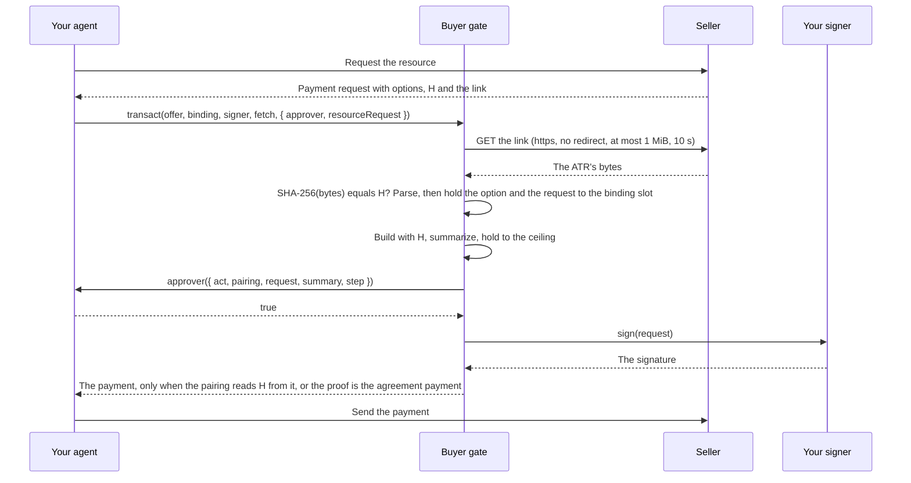

This page defines the terms the rest of the documentation uses. Each term has one meaning throughout.

## The record and its hash

**Agentic Transaction Record (ATR).** The agreement's record: the exact bytes the seller serves; `assemble` in
`@integraledger/lcp` writes them as one JSON object. It holds the terms the buyer pays under, in whatever form the
parties chose. The seller publishes it at an `https` link before it asks for payment.

**ATR hash (H).** SHA-256 over the ATR's exact bytes, written `0x` followed by 64 hexadecimal digits.

"Exact bytes" is the whole rule. H is computed over the bytes as they arrive, never over a parsed and re-serialised
copy. Two documents that mean the same JSON but differ in their bytes (`1.0` and `1`, `"café"` and `"caf\u00e9"`, a
space after a colon) have different hashes. The gate hashes the bytes it received and compares; it then parses those
same bytes, never a copy, to read the ATR's binding slot.

**Legal Context Protocol (LCP).** The pattern these packages implement: where the payment the buyer approves carries H,
that approval is the buyer's acceptance of that exact record; where it does not, the pairing's statement of what it
proves says so. The seller advertises H and the link beside its payment request. The buyer confirms that the link
serves bytes whose SHA-256 is H. On most pairings, the payment the buyer approves carries H.

## Pairings and bindings

**Pairing.** A payment protocol, scheme and rail combination, named by an id such as `x402/exact/eip155/eip3009`: the
x402 protocol, its `exact` scheme, on an EVM chain (`eip155`), paid with an EIP-3009 transfer authorization. The first
segment of the id is the protocol: `x402`, `mpp`, `spend-permissions`, `card`, `ap2`, `ucp`, `acp` or `ack`.

**Binding.** How H rides in a pairing's payment: the field of that payment, as the protocol's own specification
defines the payment, that carries H. For
`x402/exact/eip155/eip3009` it is the EIP-3009 `nonce`: the buyer signs a transfer authorization whose nonce is H. For
`mpp/charge/solana` it is a Memo instruction in the signed transaction. Each pairing has exactly one binding.

In code, a binding is an object exported by [`@integraledger/lcp`](https://lcp.integraledger.com/reference/entry-points).
It has an `id`, a `read` that finds H and the link in the seller's document, a `build` that writes H into the payment,
and a `bound` that reads H back out of a completed payment. The Python package carries the same bindings as constants,
such as `X402_EXACT_EIP155_EIP3009`. The [pairings reference](./reference/pairings.md) lists every one.

## The buyer gate

**Buyer gate.** The buyer-side check that compares the served bytes with H, and holds what is about to be signed to
the ATR, before anything is signed. It runs in your process, with your network client, your approver and your signer,
in these steps:

1. **Read.** The pairing's binding reads the seller's document: the advertised H, the `https` link to the ATR, and the
   payment options.
2. **Compare.** The gate fetches the link once and computes SHA-256 over the bytes it received. If the result is not H,
   the gate declines with `hash-mismatch`, and your signer is never called.
3. **Parse and hold.** The gate parses the bytes it hashed by one grammar both languages read alike
   (`atr-malformed` otherwise). The ATR's **binding slot** is its member named by the pairing's protocol (`x402`,
   `mpp`, `card`, ...). Where the slot lists the options offered, the option chosen must be one of them
   (`option-not-in-atr`); where the `x402` slot holds a **request commitment**, a digest of the request the seller's
   offer answered, your own request, `resourceRequest`, must be that request (`request-mismatch`).
4. **Build.** The gate builds the payment with the hash it computed, not the string the seller advertised. The result
   is a signing request: exactly what your signer signs.
5. **Show.** The gate computes the **summary** of that request, every authority the signature grants, read from the
   request itself (`summary-missing` where it cannot), and holds it to the pairing's **ceiling**, the longest the
   signed payment may stay payable (`past-ceiling`, `no-end`). `transact` then asks your **approver**, a callback you
   give, and calls the signer only when it answers `true` (`not-approved` otherwise).
6. **Finish.** When your signer answers, the gate completes the payment, and the pairing reads H back from it. The gate
   returns the payment only when that value is the hash of the bytes it compared, or, where the proof is the agreement
   payment, without that reading.

The steps, the order of their checks and the decline each answers are fixed by the profile
[`buyer-gate.md`](https://github.com/IntegraLedger/integra-agentic-terms/blob/main/agentic-terms/profiles/buyer-gate.md).

`transact` runs the steps in one call; for a pairing that needs an agreement payment, its first call returns that
payment for your agent's approval, and a second call, with `approved`, pays. `confirm` and `finish` split the steps for
an agent whose signer lives elsewhere, such as a hardware wallet or a separate signing service: `confirm` makes every
check up to the signing and returns the request with its summary, and calls no approver, so showing it is the caller's
step. `confirm` and `finish` neither pay nor check the agreement; only `transact` and `agree` do. `check` later confirms that a payment you hold
carries, inside it, the hash of the bytes you kept. For a payment with no place for H it declines `signed-not-bound`,
and the agreement receipt is the proof to keep.

## How H rides in a payment

Protocols and rails offer different places for H: a nonce, a memo, a salt, an invoice's metadata, an identifier the
protocol already defines, the seller's challenge, a field a protocol extension adds, or no place at all. The protocol
package's registry states, for each pairing, where H rides (`data.carrier`) and what the payment proves
(`data.proves`).

### Coverage

**Coverage** is the registry's statement of whether a pairing's payment is itself a public proof of H:

- **`full`**: the payer's own signed act, recorded on a public ledger, binds all of H. The payment needs no other proof.
- **`none`**: it does not. H rides in the seller's challenge, beside the payment, or not in it at all, or the payment
  is recorded on no public ledger. The payment is paid only after an agreement payment, below.

A pairing at `full` whose registry data holds `agreement` can itself be paid as another pairing's agreement payment,
and one whose `agreement` is `only` is never a charge, only an agreement. A pairing at `none` names in `agreementOn`
which agreement it can follow: one on any network, or one on its own network.

## Public proof and the agreement payment

Some payments are not a public proof of H: a card payment, a Stripe charge, a Lightning invoice, a checkout in which the
buyer signs nothing. For these pairings, at coverage `none`, the seller's offer also names an **agreement URL**: an x402
resource for the same H, paid with an x402 pairing at coverage `full`, usually for a nominal amount. The agreement
payment is a payment like any other: `transact` returns it for the buyer's agent to approve, asks the approver about it
as the act `agreement`, pays it once approved, waits for its receipt, and only then signs the main payment. Where the
seller's first response offers the agreement alone (below), `transact` pays it as soon as the approver approves it,
without returning it first. On a pairing whose
agreement has its own single-use value, the agreement payment carries that value, computed from H, where a payment for
the resource would carry H. Where the agreement URL answers the unpaid request with a receipt, `transact` makes no
agreement payment and goes on with that receipt, marked `unpaid: true` (in Python `unpaid=True`): the agreement URL's word alone. Where it offers only MPP agreement challenges, terms sends no MPP
credential: the gate returns them, signing nothing, for the buyer's own MPP client to pay. The receipt is the agreement
URL's statement: the gate checks its form
and that its `atrHash` is H, and does not look up the transaction it names. `confirm` and `finish` neither pay nor
check the agreement; only `transact` and `agree` do. The [agreement payments](./guides/agreement-payments.md) guide
covers the exchange.

If such a pairing's offer names no agreement URL, the gate declines with `agreement-not-offered` and signs nothing.

A seller may also answer first with the agreement alone, naming the charges it serves, and offer the charge only once
the buyer repeats its request with the agreement recorded (the protocol package's profile `legal-context-return.md`).
`transact` then pays the agreement, signs no charge, and returns the `Legal-Context` value to repeat the request with.
On MPP it follows the agreement URL the agreement challenges carry, and pays an x402 agreement option there.

Through a pairing whose agreement is never a charge (its registry data holds `agreement.only`, as a Spend
Permission's does), the approver is asked about every signing as the act `agreement`.

## Channels and sessions

In a payment channel (x402 batch settlement) or a session (an MPP session), one ATR covers the whole channel. The gate
compares it once, at the opening. You keep the result as a **channel hold**: the ATR's bytes, the signed opening and the
channel it names. Each later voucher is signed from the hold, under the held hash: an x402 challenge must advertise it,
and an MPP session challenge that names another hash or another channel is declined. See
[channels and sessions](./guides/channels-and-sessions.md).

## The parties

**Seller.** The party serving the resource. It assembles the ATR, stores it, serves it at the link, and advertises H in
its payment request.

**Facilitator.** The x402 role that verifies and settles a payment for the seller. The gate never talks to a
facilitator: it hands the payment back to you, and you send it to the seller. The one payment it sends itself is the
agreement payment your approver approved, to the agreement URL.

**Signer.** Your wallet, or whatever holds your keys. The gate hands it one signing request at a time and never sees a
key.

## Vectors

**Vectors.** The shared test cases that fix the rules byte for byte across languages. The TypeScript gate and the Python
gate run the same vectors, from the `vectors/` directory of `@integraledger/lcp`, and produce the same hashes, the same
requests and the same declines. See [vectors](./reference/vectors.md).

## What the gate does not do

The gate makes sure the payment you sign carries the hash of the bytes you received, and shows you what it grants. It
does not:

- interpret or judge the ATR's terms, which are for you and your principal to judge: it reads only the binding slot's
  options and, on x402, its request commitment;
- check the amount, the payee, the asset, the timing or the payer against the ATR (it shows them to your approver; a
  discrepancy is between the parties);
- carry any business or legal logic;
- hold keys or sign anything itself, or send any payment but the agreement payment your approver approved;
- store the ATR: it returns the bytes, and keeping them is yours;
- talk to a facilitator or settle a payment.
